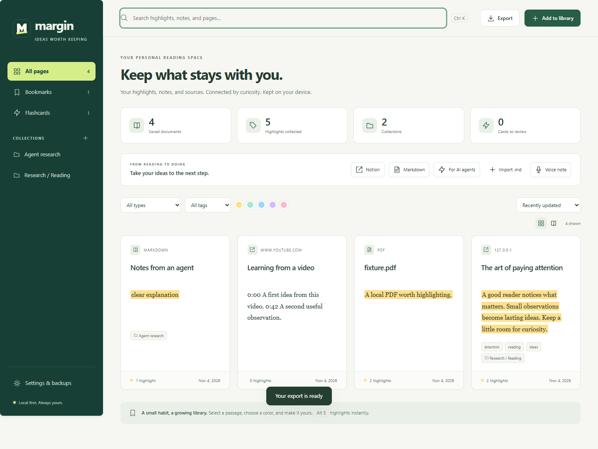

# Margin

Highlight web pages and PDFs, add notes, and find them later in a searchable library. Margin is free and open source. Your library stays in your browser by default.

[Download](https://github.com/saeidshirazi/margin-web-highlighter/releases/latest) · [Install](docs/INSTALL.md) · [Release notes](CHANGELOG.md)



## Install

Download the ZIP for [Chrome](docs/INSTALL.md#google-chrome), [Edge](docs/INSTALL.md#microsoft-edge), or [Brave](docs/INSTALL.md#brave). Unzip it and choose **Load unpacked** on the extensions page. The [Firefox XPI](docs/INSTALL.md#mozilla-firefox) is unsigned and loads as a temporary add-on.

Already using Margin? [Back up your library and update the existing installation](docs/INSTALL.md#update-without-losing-your-library).

## Features

- Highlight articles and PDFs. Add Markdown or voice notes and organize sources in collections.
- Search your library, read saved articles offline, and resume where you left off.
- Translate or listen to a selection directly from the highlight toolbar.
- Export to Markdown, Notion, or an AI agent. Optionally sync with Google Drive.

[Getting started](docs/GETTING-STARTED.md) · [Exports](docs/EXPORTS.md) · [Privacy](PRIVACY.md)

## Development

Use Node.js 24 or newer.

```sh
npm ci
npm run build:all
npm test
```

[Contributing and browser tests](CONTRIBUTING.md) · [Security](SECURITY.md) · [MIT license](LICENSE)
