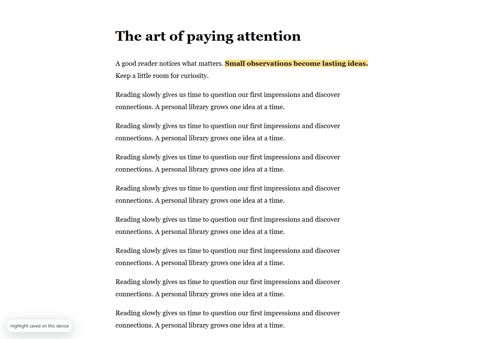
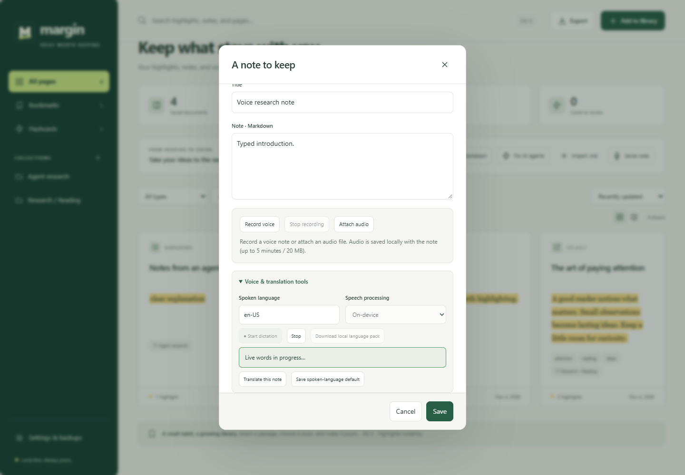
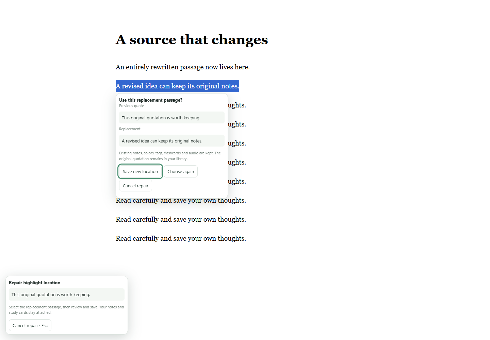
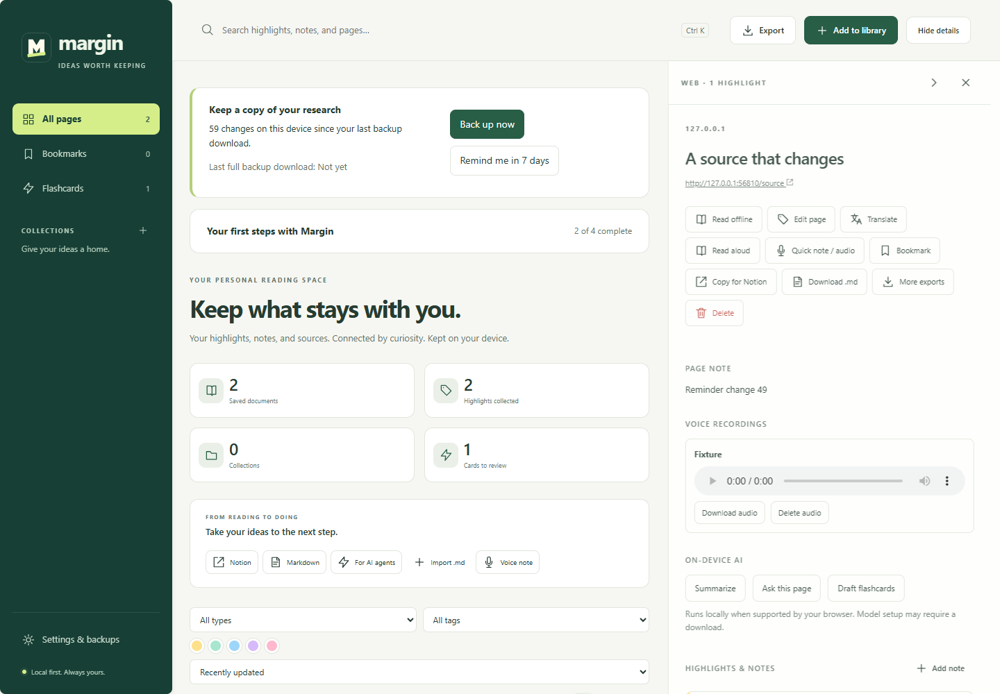

# Start with one useful sentence

[Install Margin](INSTALL.md), then open an ordinary website article and refresh the tab.

## Highlight and add a thought

1. Select a sentence with your mouse.
2. Choose a color from the floating toolbar.
3. Click the colored passage to add a note, tags, or a different color.
4. Click **Margin → Open your library** to see the source and its highlights.

You can also select text and press **Alt S**, or right-click → Margin’s highlight action. Press **Alt Q** for quick mode: selections become highlights, **1–5** change colors, and **Esc** stops it. Shortcuts may need adjusting if another app uses them.

## Find and organize

Search the library for a word from a title, URL, quote, note, or captured source text. Filter by color, tag, type, bookmark, or collection. Open a source to see its notes and quotes beside the library. Collapse details to get more space, or drag the divider to resize them. Collection names use paths such as `Research/Reading`. Parent folders appear automatically, and choosing a parent includes its subcollections. [Manage collections and save export presets](ORGANIZATION.md).

Choose **Highlights** in the library sidebar to browse individual quotes and their notes. Search by quote, highlight note, tag, or source title, and combine filters to narrow the list. **Open highlight** takes you to the saved annotation or to its location in the PDF viewer. **Copy quote with source** copies the quote, source title, web address when available, and PDF page number when known. You can also copy from the source details pane. **Export sources** exports the complete sources represented in the filtered list.

## Save an offline article

On the original article, choose **Margin → Save for offline reading**. In the library, open the source → **Read offline**. Your saved copy has shared highlights and adjustable reading settings. The saved article omits site scripts, images, styling, and embedded media; it is a reading copy, not an exact page archive.

## Add a PDF

Choose **Add to library → PDF**, select a local file or provide a remote URL, then highlight text in Margin’s viewer. **Annotated PDF** downloads the original PDF with standard highlight annotations and notes. Local PDFs work offline; remote URLs need network access and permission. Each PDF can be up to 50 MB. Image-only/scanned and password-protected PDFs are not supported.

## Pronounce or translate selected text

Select a word or short phrase on a web page, in the offline reader, or in Margin’s PDF viewer. Click the **speaker** beside the highlight colors. Margin detects the language on-device and pronounces the selection with a matching installed voice. Short or ambiguous words may use the page language, nearby text, or your voice preference. Choose **American English (US)** or **British English (UK)** in the voice menu when those voices are installed.

Click the **translation** icon to open the selection in Margin’s translation window. It starts with automatic source detection and your default output language. Choose your provider and start the translation when you are ready. These actions leave the selection unsaved.

## Record a voice note

1. On the original page, choose **Margin → Record voice / dictate**, or use **Quick note / audio** on a saved source.
2. Click **Record voice** and allow microphone access.
3. Speak, then click **Stop recording** and preview the audio.
4. Add text if useful, then save. The recording appears under the source’s **Voice recordings**.

The capture tab stays open while you highlight the original source in another tab. Recording is limited to 5 minutes / 20 MB. You can attach an existing audio file up to 20 MB. Audio stays local unless you explicitly sync or export a full backup.

**Recording** saves playable audio. **Dictation** inserts recognized text and depends on browser/language support; it is not supported by tested Firefox. **Read aloud** speaks saved text using available system/browser voices. Online speech/voices require explicit selection or consent.

## Translate into your preferred language

Choose **Translate** on a saved source or quote. Leave **From → Detect automatically**, choose a target such as `fa` for Persian, and optionally save it as your default. The default provider opens Google Translate with the selected text. Copy the translated result back into Margin’s result field, then save it to your note. Your original note stays intact. Right-to-left output is supported.

Chrome’s on-device translator requires a supported browser and language pair. Google Cloud Translation is an optional bring-your-own-key service that may charge your project. The website workflow needs no key.

If your build includes **Google Translate · free in Margin**, you can translate directly in the window with the shared Apps Script quota. For offline Persian translation, use **LibreTranslate · runs on this device**. You can also enable it as a fallback when the Google quota fills up. See [Free translation setup](FREE-TRANSLATION.md).

## Review and export

Choose **Study** beside a quote to make a flashcard. Review it from **Flashcards**; correct answers move to later review dates. For a YouTube video, open its **Show transcript** panel before using **Save for offline reading**. Captured timestamps link back to the original video; transcript availability and markup depend on YouTube.

When you want to move your research, choose **Export**. [Notion, Markdown, AI-agent and backup tutorials →](EXPORTS.md)

### Proofread a note

In a library note editor or Quick Note, open **Proofread note · English**. Suggestions appear after you pause typing. Select a suggestion’s explanation to highlight the affected phrase in your draft, then choose a replacement or **Ignore**. Margin leaves your draft unchanged until you apply a suggestion. Quoted passages, code, web addresses, and lines containing non-Latin letters are excluded. The checker runs offline and supports drafts up to 16,000 characters.

On a website, click a highlight to open its annotation popup, then open **Proofread · English** beneath the note. The compact panel shows up to two suggestions at a time. Applying a suggestion edits the draft. Choose **Save note** to save it to your library.

Before closing a temporary Firefox session, moving devices, updating, or removing the extension, make a **Full JSON backup**. It includes your complete research plus PDF/audio files.

## New in 0.7

### First-use checklist

Your library offers four small steps: make a highlight, add a note, search for it, and download a full backup. Choose **Try the practice page** for an offline introduction using the real highlighter. Practice research is saved only when you highlight; delete the practice source later if you like. **Hide guide** keeps it out of the way. Reopen it from **Settings & backups → Show getting-started guide**. Progress stays on this device.

### Repair a missing or moved highlight

1. Open the source in your library and choose **Repair location** beside the quote.
2. Choose the original website or its saved offline article.
3. Select the replacement passage. Review the previous and replacement quotations in the confirmation panel.
4. Choose **Save new location**, **Choose again**, or **Cancel repair**. Escape also cancels.

Repair updates the same highlight instead of creating a duplicate. Notes, tags, color, flashcards and audio stay attached. **Original quote before repair** in the library preserves the first quotation, and the last 10 replaced locations are retained in full backups and optional sync. A highlight edited elsewhere must be reopened before repairing, preventing accidental overwrites. If a live quote changes, an older offline copy may not contain it; recapture the article if needed. PDF location repair is not included yet.

### Keep a recent backup

A quiet reminder appears in the library after **7 days or 50 research changes on this device**, provided there are unbacked changes. **Back up now** opens the full JSON export; an optional password encrypts it. **Remind me in 7 days** snoozes the prompt.

In Settings, choose 7/14/30 days or 50/100/250 changes, disable reminders, and see the last full backup download request. Markdown/Notion/agent exports do not count as full backups. Changes made while a backup is being prepared remain pending. Reminder counters and tutorial progress never travel in research backups or Drive sync.

The browser cannot confirm that you kept the downloaded file or accepted its save prompt. Check your downloads before relying on it. Imported research, deletion markers and independent exported files follow the existing backup/sync rules. No new notifications, account requirements or permissions were added.

## Research tools

- **Key points.** Open a source or highlight in the library and choose **Key points**. Margin selects up to four excerpts from saved text on your device. Use **Save to note** to append them to the existing note.
- **Explain.** Choose **Explain** beside a highlight, then **Generate explanation**. A compatible on-device model uses the quote and nearby saved text. The current local model configuration uses English. Chrome may download the model on first use. Review the response before saving it.
- **Continue reading.** Open an offline article or PDF and scroll or change pages. The library’s **Continue reading** section reopens recent sources at their saved position. Click its heading to collapse or expand it. To sync positions, connect the same Google account and enable **Sync reading positions** under **Settings & backups → Connect your Google account** in each browser. The most recently saved position wins for each source. Use **Sync now** before switching browsers to transfer a recent change right away. The collapsed state stays local.
- **Search.** Type a phrase in the library search box to see it in context. The result’s button takes you to the matching annotation, note, offline text, or indexed PDF page. PDF text search covers up to the first 500 indexed pages.
- **Restore a backup.** In **Settings & backups**, choose **Import backup** and select a JSON file. Unlock encrypted files with their password. Review the added, merged, and skipped counts before clicking **Restore backup**. Review the final report for local details that were kept and presets that were renamed.
