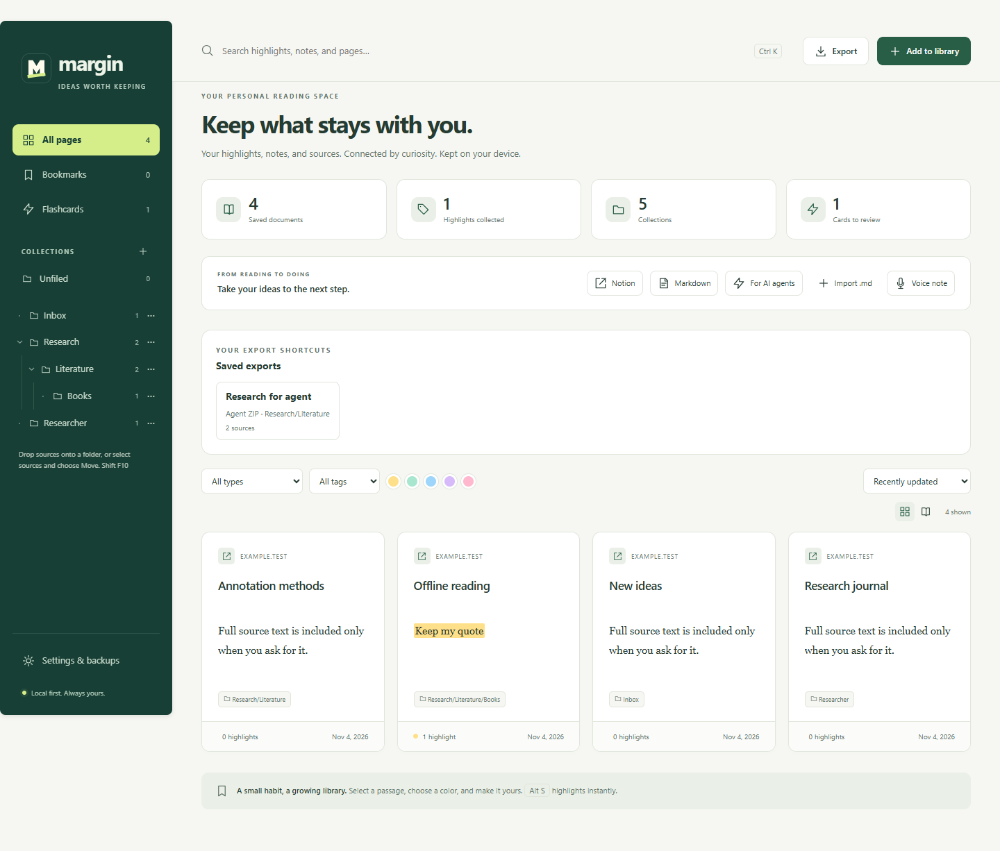

# Organize and export with less repetition

## Nested collections

A path such as `Research/Reading/Books` creates a browsable hierarchy. Parent folders appear automatically. Choose a parent to see sources in that folder **and all subcollections**. Counts include descendants. **Unfiled** shows sources without collection labels.

Collections are stored with their sources. Empty folders are not stored separately: choose at least one source when creating a collection. Existing path-style collections continue to work without a database migration. A selected collection can be bookmarked through the library URL and survives a reload.

### Create, rename, move, or remove

- **Create:** choose **+** beside Collections, enter a path, select sources, and save.
- **Rename:** choose **⋯** beside a folder → **Rename**. The entire branch moves to its new name.
- **Move a branch:** choose **⋯ → Move collection**, then enter a parent path. A blank parent moves the branch to the root. You can also drag a folder onto another folder.
- **Remove labels:** choose **⋯ → Remove collection labels**. Its sources become Unfiled. No sources, highlights, notes, cards or audio are deleted.

Rename/move operations reject an existing destination instead of silently merging folders. Moving a folder into its own descendants is also rejected. Local collection-scoped export presets follow a renamed or moved branch.

### Move multiple sources

Select source checkboxes and choose **Move to collection**, or press **Alt M**. Enter a collection path; a blank path means Unfiled. You can also drag one source onto a sidebar folder. If the dragged source is selected, all selected sources move together. Drag sources onto **Unfiled** to remove their labels.

Changes are atomic: if a selected source disappeared, none of the selected sources are moved. Source IDs and their linked notes, highlights, flashcards and attachments stay intact.

### Keyboard and undo

Tab through folders and their **⋯** controls. **Up/Down** moves focus between visible folders; **Right/Left** expands or collapses a branch, or moves focus to a child/parent. **Enter/Space** selects a focused folder. **Shift F10** opens its management dialog. Native buttons and checkboxes provide alternatives to dragging.

After an organization change, use **Undo last organization change**. It restores only collection labels, keeping note edits made afterward. If a source was moved or deleted afterward, undo refuses the whole operation rather than partially overwriting newer organization. Only the most recent organization action in the current library tab can be undone; reloading the tab clears that receipt.

## Saved export presets

1. Open **Export**, choose a research format, and expand **Save or reuse an export preset**.
2. Choose its scope: **current selection / filtered view**, **entire library**, or **collection and subcollections**.
3. Set the metadata and full-source-text choices, enter a name, and choose **Save new preset**.
4. Use its **Saved exports** shortcut in the library for a one-click download, clipboard action, or print workflow.

To edit a preset, choose it in the export center, adjust its settings, then choose **Update preset**. **Delete preset** removes the configuration, never your research. Up to 20 presets are supported. Presets do not store passwords, API keys, account connections, or full-backup formats.

Scope is explicit. A missing/empty collection stops the export with an explanation; it never falls back to the entire library. The shortcut displays its format and scope, source count, and whether full saved source text is included. The current-view scope uses selected sources when any are selected, otherwise the current filtered results.

Presets are saved on this browser and included in complete JSON/encrypted backups. Import merges them, preserves existing presets, and renames imported name collisions. Margin 0.8 or later restores the preset field; older versions can restore research but ignore preset metadata. Google Drive synchronizes research collection labels, **not presets**. A rename performed by another device may leave a local preset pointing to a missing path; choose a new collection in the export center.

[Export formats](EXPORTS.md) · [Backup and privacy](../PRIVACY.md) · [Installation](INSTALL.md)
